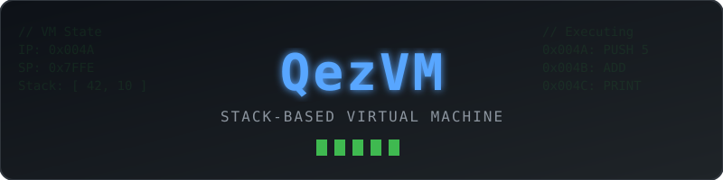

# QezVM ⚙️

**Виртуальная машина для выполнения байт-кода языка Qora.**

> ⚠️ **Внимание:** QezVM находится в ранней стадии разработки. Спецификация байт-кода и API могут меняться. Проект не готов к использованию в продакшене.

)

---

## 📖 О проекте

**QezVM** — это стековая виртуальная машина, написанная на C. Она создана для выполнения байт-кода, который генерирует компилятор **[QCC](https://github.com/QeZzhi/QCC)** из исходного кода на языке **Qora**.

**Зачем это нужно?**
Вместо того чтобы компилировать Qora напрямую в машинный код для каждого микроконтроллера (ESP32, ARM и т.д.), мы компилируем его в универсальный байт-код. QezVM берет на себя всю работу по его исполнению. Это позволяет запускать один и тот же код на разных устройствах, не переписывая компилятор.

**Особенно актуально для QezOS:** QezVM будет использоваться как система плагинов. Вы сможете писать расширения для ОС на Qora, и QezVM безопасно их выполнит.

## 🏗 Архитектура VM

QezVM — это классическая стековая машина. Вот её основные компоненты:

*   📦 **Стек операндов (Operand Stack):** Главный рабочий инструмент. Все математические операции и вызовы функций происходят через него.
*   🧠 **Память (Memory):** Выделенная область для хранения глобальных переменных и кучи (heap).
*   🎯 **Регистры управления:** Счетчик команд (`IP` — Instruction Pointer) и указатель стека (`SP` — Stack Pointer).
*   ⚡ **Набор инструкций (ISA):** Поддержка базовых операций (арифметика, логика, переходы, работа со стеком).

## 🛠 Стек
- **Язык:** C (стандарт C11)
- **Архитектура:** Стековая VM
- **Интеграция:** QCC (компилятор) + QezOS (ОС)

## 🚀 Как собрать

🚧 *Проект находится в стадии активной разработки. Инструкция по сборке появится сразу после завершения ядра виртуальной машины.*

## 🗺 Планы (Roadmap)

- [x] Базовая структура проекта и определение типов данных.
- [ ] Реализация стека и базовых инструкций (PUSH, POP, ADD, SUB).
- [ ] Загрузка и разбор байт-кода (файлы `.qbc`).
- [ ] Реализация условных переходов (JMP, JZ, JNZ).
- [ ] Вызов функций и работа с локальными переменными.
- [ ] Интеграция с QezOS (система плагинов).

## 👨‍💻 Автор

**Эмир (QeZzhi)** — 14 лет. Системное программирование, C/C++, компиляторы.
